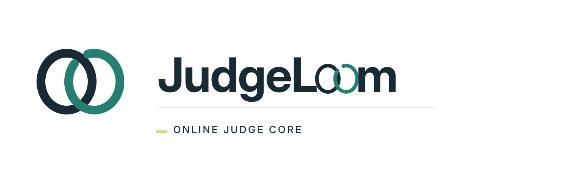
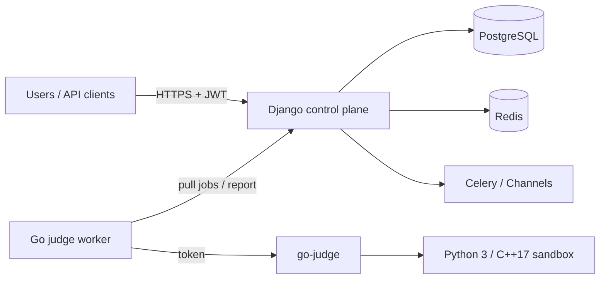

<div align="center">
  <picture>
    <source media="(prefers-color-scheme: dark)" srcset="docs/assets/logo-dark.svg" />
    <source media="(prefers-color-scheme: light)" srcset="docs/assets/logo.svg" />
    
  </picture>

  # 🚀 JudgeLoom

  **API-first online judge control plane with a sandboxed Go judge worker.**

  [](https://github.com/ThanhNguyxnOrg/judgeloom-core/actions/workflows/ci.yml)
  [](https://github.com/ThanhNguyxnOrg/judgeloom-core/actions/workflows/codeql.yml)
  [](https://www.python.org/)
  [](https://www.djangoproject.com/)
  [](https://go.dev/)
  [](https://www.postgresql.org/)
  [](https://redis.io/)
  [](https://docs.docker.com/compose/)
  [](LICENSE)
  [](docs/README.md)
</div>

<br />

> [!NOTE]
> **JudgeLoom** is an active, API-first core. The Django control plane, Go
> worker, and go-judge sandbox are implemented; a web UI is intentionally out of
> scope. Start with the **[Quickstart](docs/getting-started/quickstart.md)** or
> browse the **[documentation hub](docs/README.md)**.

---

## ✨ Why JudgeLoom?

- 🔒 **Control and execution are separate.** Django never runs participant code.
- ⚖️ **Pull-based judge workers.** Workers claim leased jobs and report
  per-case results; the server remains the scoring authority.
- 📦 **Immutable packages.** Test data is SHA-256-addressed, hashed per file,
  cached by workers, and safe for rejudges.
- 🧪 **Real sandboxing.** go-judge runs Python/C++ with CPU, memory, process,
  output, and filesystem limits.
- 🧰 **Testlib ecosystem.** Inline checkers, validators, interactive checkers,
  and a package-authoring CLI with embedded Testlib support.
- 🏆 **Contest-ready domain.** ICPC/IOI/AtCoder/ECOO formats, freeze,
  participation-bound submissions, Elo-MMR ratings.
- 📡 **Typed API and live updates.** Django Ninja + Pydantic + Channels.
- 🛡️ **Operationally hardened.** JWT/session auth, hashed judge tokens, Redis
  auth, production secret validation, read-only/authenticated go-judge.
- 🧭 **Docs that link together.** Every operational path has a runbook and
  cross-links to the next step.

---

## 🏛️ Architecture at a glance



Read the full [architecture overview](docs/architecture/overview.md) and
[security model](docs/architecture/security.md).

---

## 🚀 Quick start

### Docker Compose (full stack)

```bash
git clone https://github.com/ThanhNguyxnOrg/judgeloom-core.git
cd judgeloom-core
cp .env.example .env
# set DJANGO_SECRET_KEY, POSTGRES_PASSWORD, REDIS_PASSWORD,
# GO_JUDGE_AUTH_TOKEN, JUDGELOOM_JUDGE_TOKEN, JUDGELOOM_JUDGE_NAME

docker compose up -d --build postgres redis web go-judge
docker compose exec web python manage.py migrate
docker compose exec web python manage.py seed_users
docker compose exec web python manage.py seed_languages
docker compose exec web python manage.py seed_problems

curl -fsS http://127.0.0.1:8000/api/health/ready
```

Then follow **[Your first submission](docs/getting-started/first-submission.md)**
to import a package, start the worker, and get a real verdict.

### Local Python

```bash
python -m venv .venv
source .venv/bin/activate            # Windows: .venv\Scripts\activate
pip install -r requirements/base.txt -r requirements/testing.txt

cp .env.example .env
# Leave DATABASE_URL empty for SQLite, or set PostgreSQL.
python manage.py migrate
python manage.py seed_users
python manage.py seed_languages
python manage.py seed_problems
python manage.py runserver
```

- Swagger: <http://127.0.0.1:8000/api/docs>
- Health: <http://127.0.0.1:8000/api/health/ready>
- Full guide: [Quickstart](docs/getting-started/quickstart.md)

---

## 📚 Documentation map

| Start | Understand | Operate | Reference |
| :--- | :--- | :--- | :--- |
| [🏁 Quickstart](docs/getting-started/quickstart.md) | [🏛️ Architecture](docs/architecture/overview.md) | [🚢 Deployment](docs/operations/deployment.md) | [📡 API](docs/reference/api.md) |
| [⚙️ Configuration](docs/getting-started/configuration.md) | [🔐 Security](docs/architecture/security.md) | [🧯 Troubleshooting](docs/operations/troubleshooting.md) | [📦 Package format](docs/reference/package-format.md) |
| [🎯 First submission](docs/getting-started/first-submission.md) | [⚖️ Protocol v1](docs/judge/protocol-v1.md) | [🧪 Testing](docs/development/testing.md) | [📖 Glossary](docs/reference/glossary.md) |
| [🧰 Package authoring](docs/judge/package-authoring.md) | [🤖 Worker runbook](docs/judge/worker.md) | [🤝 Contributing](CONTRIBUTING.md) | [📚 Docs hub](docs/README.md) |

---

## 🛠️ Tech stack

| Layer | Technology | Role |
| :--- | :--- | :--- |
| Control plane | Django 5.2 | Domain, ORM, admin, auth |
| API | Django Ninja + Pydantic v2 | Typed REST + OpenAPI |
| Real-time | Django Channels | WebSocket submission/contest feeds |
| Async | Celery + Redis | Background tasks and maintenance |
| Primary DB | PostgreSQL 16 | Durable relational state |
| Cache/broker | Redis 7 | Cache, sessions, Celery, Channels |
| Judge worker | Go 1.27 | Pull loop, package cache, execution |
| Sandbox | go-judge 1.13.3 | Namespace/cgroup isolation |
| Checkers | Testlib / exact / interactive | Verdict contracts |
| Authoring | `judgeloom-package` | Generator + solution → static ZIP |

---

## 📂 Project structure

```text
judgeloom-core/
├── apps/                 # Domain apps: accounts, problems, contests, submissions, judge, ...
├── config/               # Settings, URLs, ASGI/WSGI, Celery
├── core/                 # Events, permissions, middleware, shared models/utilities
├── worker/               # Go judge worker + package authoring CLI
├── tests/                # Pytest suite
├── docs/                 # Documentation hub and runbooks
├── docker/               # Dockerfiles for web, judge worker, go-judge
├── docker-compose.yml    # Development stack
└── docker-compose.prod.yml
```

---

## 🧪 Quality gates

```bash
pytest -q
ruff check .

cd worker
go vet ./...
go test ./...
```

Real sandbox integration (requires Docker + go-judge):

```bash
bash worker/scripts/test-sandbox.sh
```

The repository also verifies Compose renders, a production image build, and
production secret validation. See [Testing](docs/development/testing.md) for the
full matrix.

---

## 🔐 Security

- Report vulnerabilities privately via [`SECURITY.md`](SECURITY.md).
- Read the [security model](docs/architecture/security.md) before deployment.
- Never commit `.env`, tokens, private packages, or database dumps.
- Production requires explicit secrets and a TLS reverse proxy.
- go-judge is privileged: run it on a dedicated judge host and keep it off the
  public network.

---

## 🤝 Contributing

We welcome contributions. Read [`CONTRIBUTING.md`](CONTRIBUTING.md) and the
[development/testing guide](docs/development/testing.md).

1. Fork and create a topic branch.
2. Add tests and update docs.
3. Run the quality gates.
4. Commit with [Conventional Commits](https://www.conventionalcommits.org/).
5. Open a PR against `master`.

By participating, you agree to the [`CODE_OF_CONDUCT.md`](CODE_OF_CONDUCT.md).

---

## 📄 License

Distributed under the **GNU Affero General Public License v3.0**. See
[`LICENSE`](LICENSE) for the full text.

---

<div align="center">
  <sub>Built with ❤️ for the competitive programming community.</sub><br />
  <a href="docs/README.md">Documentation hub</a> ·
  <a href="docs/getting-started/quickstart.md">Quickstart</a> ·
  <a href="docs/architecture/overview.md">Architecture</a> ·
  <a href="SECURITY.md">Security</a>
</div>
