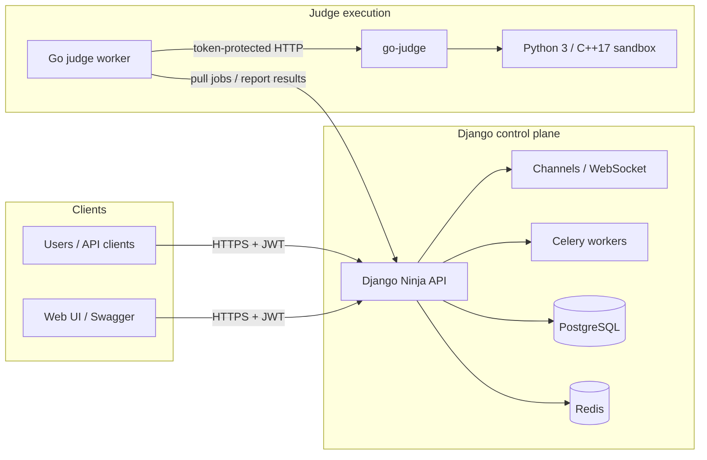
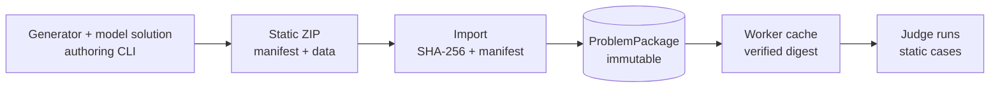

[🏠 Project README](../../README.md) · [📚 Documentation](../README.md) · [← First submission](../getting-started/first-submission.md) · [Next: Security →](security.md)

# 🏛️ Architecture overview

JudgeLoom separates **control** from **execution**:

- The **Django control plane** owns identity, problems, contests, submissions,
  scoring, and package metadata.
- The **Go judge worker** pulls leased jobs, downloads immutable packages, and
  runs code in **go-judge**.
- The **sandbox** runs participant code with CPU, memory, process, and output
  limits.

The control plane never runs participant code.

---

## 🗺️ System diagram

---

## 🧱 Components

| Component | Responsibility | Code |
| :--- | :--- | :--- |
| Django control plane | API, auth, contests, submissions, scoring | `apps/`, `config/` |
| Judge gateway | Worker-only register/claim/result API | `apps/judge/api/gateway.py` |
| Go worker | Pull loop, package cache, compile/run, report | `worker/` |
| go-judge | Sandbox execution service | `docker/Dockerfile.gojudge` |
| Celery | Background tasks and maintenance | `apps/*/tasks.py`, `config/celery.py` |
| Channels | Live submission/contest feeds | `apps/submissions/consumers.py` |
| Package authoring CLI | Generator + model solution → static ZIP | `worker/cmd/judgeloom-package` |

---

## 🔄 Submission lifecycle

1. A user submits source through `POST /api/submissions/`.
2. The control plane validates visibility, language, limits, and package state.
3. A `JudgeJob` is queued with the active package SHA-256.
4. A worker claims the job with a lease and downloads the package.
5. The worker compiles the source and runs each case in go-judge.
6. The worker posts per-case results and `finish`.
7. The control plane recomputes points, verdict, subtitle groups, contest
   ranking, and emits events/WebSocket updates.
8. The worker acknowledges the final state; expired leases are retried up to the
   configured attempt limit.

The server is the **source of truth for scoring**. Worker-reported totals are
cross-checks, not authority.

---

## 📦 Package lifecycle

Properties:

- Packages are content-addressed by SHA-256.
- Only one package per problem is active at a time, but old packages remain
  downloadable for queued jobs and rejudges.
- Changing cases, checker, groups, or points requires a new package version.
- Runtime limits and contest points live on the problem/contest metadata, not
  the package.

See [Package format](../reference/package-format.md) and
[Package authoring](../judge/package-authoring.md).

---

## 🗃️ Data model at a glance

| Entity | Purpose |
| :--- | :--- |
| `User` | Account, roles, rating, token version |
| `Problem` | Metadata, limits, visibility, maintainers |
| `ProblemPackage` | Immutable test-data version |
| `ProblemTestCase` | Case files, hashes, points, group |
| `Submission` | Source, result, scores, visibility, mode |
| `JudgeJob` | Lease/ownership state for a submission |
| `Judge` | Worker record, hashed token, capabilities, heartbeat |
| `Contest` / `ContestParticipation` | Contest lifecycle and ranking |
| `Rating` | Elo-MMR rating history |
| `ShadowJob` | Non-scoring replay lane |
| `Organization` | Private problem/post scoping |

Detailed source: `apps/*/models/`.

---

## 🧩 Design principles

- **Thin models and views; services own logic.** Business rules live under
  `apps/<app>/services/`.
- **Events for cross-app side effects.** `core.events` decouples ranking,
  notifications, and WebSocket updates.
- **Typed boundaries.** Django Ninja + Pydantic validate API input; Go structs
  validate the worker contract.
- **Immutable test data.** Packages are hashed and cached, never mutated.
- **Server-side scoring.** The worker returns observations; the control plane
  computes the final verdict.
- **Defense in depth.** JWT/session auth, hashed judge tokens, package path
  validation, sandbox limits, Redis auth, and production secret guards.

---

## 🧪 Development vs production

| Concern | Development | Production |
| :--- | :--- | :--- |
| Settings | `config.settings.development` | `config.settings.production` |
| Database | PostgreSQL when `DATABASE_URL` is set, otherwise SQLite | PostgreSQL |
| Cache/channels | In-memory by default | Redis |
| HTTPS | Optional local HTTP | Required behind a TLS proxy |
| Web bind | `0.0.0.0:8000` in Compose dev | `127.0.0.1:8000` |
| Secrets | Dev defaults | Explicit, validated secrets |

---

## 🔗 Related documentation

- [Security model](security.md)
- [Production deployment](../operations/deployment.md)
- [Judge protocol v1](../judge/protocol-v1.md)
- [Worker runbook](../judge/worker.md)
- [API reference](../reference/api.md)

---

  ← <a href="../getting-started/first-submission.md">First submission</a> · <a href="../README.md">Documentation hub</a> · <a href="security.md">Security</a> →

