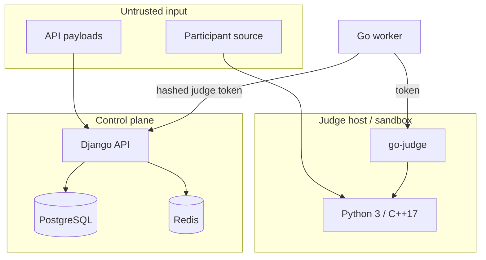

[🏠 Project README](../../README.md) · [📚 Documentation](../README.md) · [← Architecture](overview.md) · [Next: Deployment →](../operations/deployment.md)

# 🔐 Security model

JudgeLoom treats the **control plane**, **judge worker**, **sandbox**, and
**participant code** as different trust levels. This page explains the controls
and the checks you must perform outside the repository.

> [!IMPORTANT]
> Report vulnerabilities privately via [`SECURITY.md`](../../SECURITY.md). Do
> not open a public issue for a suspected vulnerability.

---

## 🧱 Trust boundaries



- Participant code is untrusted and runs only inside go-judge.
- The worker is trusted infrastructure but has no database credentials.
- The control plane trusts only authenticated API principals and validated
  packages.
- Host-level access to the worker/go-judge host is equivalent to judge trust.

---

## 🪪 Authentication and authorization

| Principal | Mechanism | Notes |
| :--- | :--- | :--- |
| Browser/session user | Django session | Same-site cookies, secure flags in production |
| API user | JWT HS256 bearer | 1-hour access token, bounded refresh |
| Judge worker | Per-judge bearer token | Stored as SHA-256 verifier, never plaintext |
| Judge admin | Staff JWT/session | Block/unblock, metrics, token creation |

Additional controls:

- JWT token versioning revokes outstanding tokens on logout/password change.
- Judge tokens are generated once and stored as hashes.
- API routes use explicit auth dependencies; submissions accept JWT and session.
- Private submissions, source, and test-case output are owner/staff/maintainer
  scoped.
- Rate limits apply to register/login, run, and submission paths.
- `TRUST_X_FORWARDED_FOR` is disabled unless a trusted proxy is configured.

---

## 📦 Package and sandbox controls

- ZIP import rejects path traversal, duplicate stems, oversized archives, and
  excessive case counts.
- Each case file is SHA-256 hashed; the active package is content-addressed.
- Testlib checker/validator/generator sources are compiled inside sandboxed
  go-judge, with the vendored header injected automatically.
- Worker validates the package digest before extraction and verifies case
  hashes before execution.
- go-judge runs with CPU, memory, process, output, and filesystem limits.
- Production go-judge:
  - `-no-fallback` (never silently run without isolation),
  - bearer-token auth on execution endpoints,
  - read-only root filesystem + writable `/tmp`,
  - no published host port,
  - internal `judge_net` network,
  - dedicated host/VM recommended.

See [Worker runbook](../judge/worker.md) and
[Package authoring](../judge/package-authoring.md).

---

## 🔑 Production secrets

Production settings reject known placeholders and short signing keys:

```python
# config/settings/secret.py
SECRET_KEY = validate_secret_key(SECRET_KEY)
```

Required deployment secrets:

| Secret | Purpose |
| :--- | :--- |
| `DJANGO_SECRET_KEY` | JWT signing and Django secret material |
| `POSTGRES_PASSWORD` | Database authentication |
| `REDIS_PASSWORD` | Redis authentication |
| `JUDGELOOM_JUDGE_TOKEN` | Worker → control-plane auth |
| `GO_JUDGE_AUTH_TOKEN` / `GO_JUDGE_TOKEN` | Worker → go-judge auth |
| `FLOWER_BASIC_AUTH` | Flower UI basic auth |

Never commit `.env`, tokens, database dumps, or package archives containing
private tests. `.dockerignore` excludes `.env`, local databases, and backups.

---

## 🚢 Deployment controls

| Control | Where |
| :--- | :--- |
| HTTPS/HSTS/secure cookies | `config/settings/production.py` |
| Web bind to loopback | `docker-compose.prod.yml` |
| Postgres/Redis no host ports | `docker-compose.prod.yml` |
| Flower loopback + basic auth | `docker-compose.prod.yml` |
| Redis `--requirepass` | Compose + `REDIS_PASSWORD` |
| go-judge token/no-fallback/read-only | `docker-compose.yml` |
| Internal judge network | `judge_net` |
| Secret validation | `config/settings/secret.py` |

> [!WARNING]
> TLS termination, DNS, host firewall, and the real production `.env` are
> deployment-owner responsibilities. A local Compose render cannot prove those.

---

## 🔬 Verification snapshot

The repository is checked with:

- Django tests, Ruff, Go unit tests, and real go-judge integration tests.
- Compose renders for development and production.
- A production image build (`collectstatic` against production settings).
- Semgrep (official + Trail of Bits, dgryski, elttam, kondukto, Apiiro).

The latest local Semgrep run completed **12/12 scans with 0 failed/skipped**
(one third-party ruleset had a partial compile) and reported **42 warnings,
0 errors, 0 secrets**. The warnings were environment/context findings:

- 31 plaintext Redis URLs (internal network / CI; production Redis is
  password-protected and not host-published),
- 6 dev/CI port bindings (production web/Flower are loopback; DB/Redis are not
  published),
- 2 migration “minified” false positives,
- 1 `secret.py` error-message false positive,
- 1 ORM `order_by` allowlist false positive,
- 1 distroless recommendation.

Two real code findings were fixed during the scan: Django password validators
and `errors.Is` for a missing cache directory.

> [!NOTE]
> A scan is a snapshot, not a guarantee. Re-run it after security-relevant
> changes and follow the reporting process in [`SECURITY.md`](../../SECURITY.md).

---

## 🔗 Related documentation

- [Production deployment](../operations/deployment.md)
- [Troubleshooting](../operations/troubleshooting.md)
- [Worker runbook](../judge/worker.md)
- [Protocol v1](../judge/protocol-v1.md)
- [Security policy](../../SECURITY.md)

---

<div align="center">
  <sub>← <a href="overview.md">Architecture</a> · <a href="../README.md">Documentation hub</a> · <a href="../operations/deployment.md">Deployment</a> →</sub>
</div>
