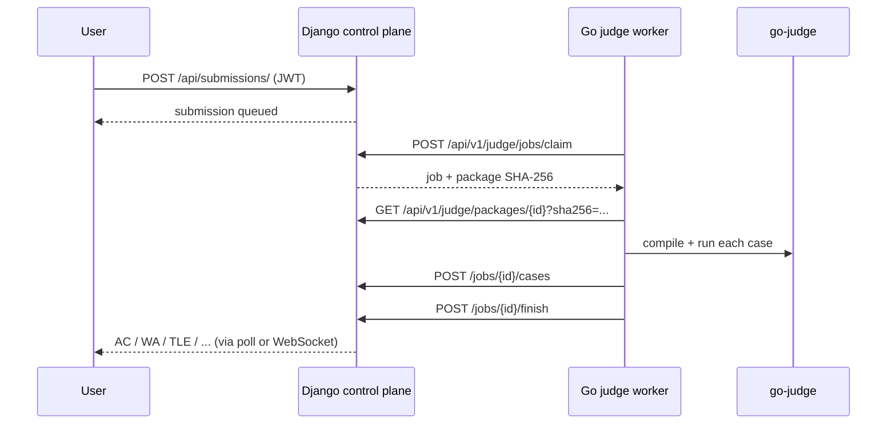

[🏠 Project README](../../README.md) · [📚 Documentation](../README.md) · [← Quickstart](quickstart.md) · [Next: Architecture →](../architecture/overview.md)

# 🎯 Your first submission

This walkthrough takes a seeded local stack from **problem package** to a real
sandboxed verdict. It uses the development Compose stack, `aplusb`, Python 3,
and the pull-based Go worker.

> [!NOTE]
> Commands assume the stack from the [Quickstart](quickstart.md) is running and
> the database has been migrated and seeded.

---

## 1. Create an importable package

JudgeLoom packages are immutable ZIP archives with a `manifest.json` and case
files. Create a minimal `aplusb` package:

```bash
python - <<'PY'
import json
import zipfile

manifest = {
    "schema": 1,
    "problem_code": "aplusb",
    "time_limit": 1.0,
    "memory_limit": 262144,
    "checker": {"type": "exact"},
    "cases": [
        {"id": "01", "input": "data/01.in", "answer": "data/01.ans", "points": 50, "group": "default"},
        {"id": "02", "input": "data/02.in", "answer": "data/02.ans", "points": 50, "group": "default"},
    ],
    "groups": [{"id": "default", "points": 100, "mode": "sum"}],
}

with zipfile.ZipFile("aplusb.zip", "w") as archive:
    archive.writestr("manifest.json", json.dumps(manifest))
    archive.writestr("data/01.in", "1 2\n")
    archive.writestr("data/01.ans", "3\n")
    archive.writestr("data/02.in", "10 20\n")
    archive.writestr("data/02.ans", "30\n")
PY

docker compose exec -T web python manage.py import_problem_package aplusb /app/aplusb.zip
```

Expected output resembles:

```text
Imported aplusb package v1 (<sha256>, active) with 2 cases.
```

The package SHA-256 is the identity used by every judge. Changing test data
requires a new package version; see [Package format](../reference/package-format.md).

---

## 2. Register a judge and start the worker

Create a judge record and capture its one-time token:

```bash
TOKEN=$(docker compose exec -T web python manage.py create_judge_token demo-judge \
  | sed -n 's/^Token (shown once): //p')

JUDGELOOM_JUDGE_TOKEN="$TOKEN" \
JUDGELOOM_JUDGE_NAME=demo-judge \
docker compose up -d judge-worker
```

Check that the worker self-test passed:

```bash
docker compose logs --tail 20 judge-worker
```

You should see the go-judge build version and a startup line ending in
`http://web:8000/api/v1/judge`.

> [!TIP]
> The worker base URL **must** include `/api/v1/judge`. A URL ending in
> `/api/v1` produces `404 /api/v1/register`. The worker cache volume is owned by
> the non-root `judgeloom` user; see [Worker runbook](../judge/worker.md) for
> existing-volume migration.

---

## 3. Log in and find a language id

Seed users use password `judgeloom2025` by default:

```bash
JWT=$(curl -s -X POST http://127.0.0.1:8000/api/accounts/login \
  -H 'Content-Type: application/json' \
  -d '{"username_or_email":"alice","password":"judgeloom2025"}' \
  | python -c 'import json,sys; print(json.load(sys.stdin)["access_token"])')

curl -s http://127.0.0.1:8000/api/judge/languages
```

Use the `id` of the `PY3` entry as `<language-id>` below.

---

## 4. Submit

```bash
curl -s -X POST http://127.0.0.1:8000/api/submissions/ \
  -H "Authorization: Bearer $JWT" \
  -H 'Content-Type: application/json' \
  -d '{
    "problem_code": "aplusb",
    "language_id": <language-id>,
    "source_code": "a, b = map(int, input().split())\nprint(a + b)\n"
  }'
```

The response is a submission with `"status": "Q"` (queued). Poll it:

```bash
curl -s http://127.0.0.1:8000/api/submissions/<submission-id> \
  -H "Authorization: Bearer $JWT"
```

A completed run returns fields such as:

```json
{
  "status": "CM",
  "result": "AC",
  "points": 100.0,
  "case_total": 2,
  "case_passed": 2
}
```

Try a wrong answer with `print(0)` to see `WA` and `0` points. The worker never
invents points: the control plane recomputes the score from persisted case
results and the immutable package manifest.

---

## 5. What just happened?



Read [Architecture](../architecture/overview.md) for the full lifecycle and
[Judge protocol v1](../judge/protocol-v1.md) for the wire contract.

---

## 🧯 If it does not work

| Symptom | Check |
| :--- | :--- |
| Worker logs `404 /api/v1/register` | Set `JUDGELOOM_API_URL` to `.../api/v1/judge` |
| Worker logs `401` | Token must match the judge record; rotate with `create_judge_token --rotate` |
| `permission denied` on worker cache | Recreate/chown the cache volume to uid `10001` |
| Submission stays `Q` | Worker online? Language claimed? Active package? |
| `NOAUTH` from Redis | Set `REDIS_PASSWORD` and password-bearing URLs |

Full checklist: [Troubleshooting](../operations/troubleshooting.md).

---

## 🧭 Next steps

- [Architecture overview](../architecture/overview.md)
- [Judge worker runbook](../judge/worker.md)
- [Package authoring](../judge/package-authoring.md)
- [API reference](../reference/api.md)

---

<div align="center">
  <sub>← <a href="quickstart.md">Quickstart</a> · <a href="../README.md">Documentation hub</a> · <a href="../architecture/overview.md">Architecture</a> →</sub>
</div>
