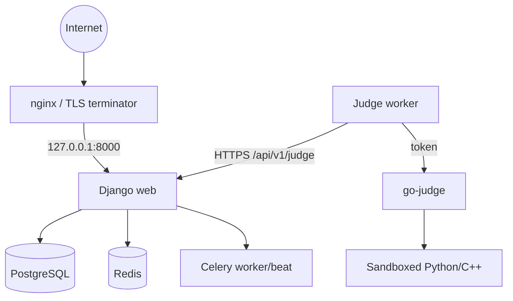

[🏠 Project README](../../README.md) · [📚 Documentation](../README.md) · [← Security](../architecture/security.md) · [Next: Troubleshooting →](troubleshooting.md)

# 🚢 Production deployment

This guide describes the single-host Docker Compose reference deployment. For
serious workloads, run the judge worker and go-judge on a **dedicated judge
host** and treat that host as trusted infrastructure.

> [!WARNING]
> go-judge is privileged because it creates namespaces and cgroups. A sandbox
> escape is a host compromise. Do not co-locate it with unrelated workloads.

---

## 🧱 Topology



- The production overlay binds `web` to `127.0.0.1:8000`; only a local reverse
  proxy reaches it.
- PostgreSQL, Redis, and go-judge publish **no host ports**.
- Flower is loopback-only and requires basic auth.
- The worker joins the default network for the control plane and `judge_net`
  for go-judge.

---

## 1. Prepare secrets

```bash
cp .env.example .env
```

Set at least:

```dotenv
DJANGO_SECRET_KEY=<unique 50+ character key>
DJANGO_ALLOWED_HOSTS=judgeloom.example.com
POSTGRES_PASSWORD=<random password>
REDIS_PASSWORD=<random url-safe password>
JUDGELOOM_JUDGE_TOKEN=<from create_judge_token>
JUDGELOOM_JUDGE_NAME=judge-worker-1
JUDGELOOM_API_URL=https://judgeloom.example.com/api/v1/judge
GO_JUDGE_AUTH_TOKEN=<random token>
FLOWER_BASIC_AUTH=flower:<random password>
```

Generate the Django key:

```bash
python -c "from django.core.management.utils import get_random_secret_key; print(get_random_secret_key())"
```

> [!IMPORTANT]
> Production settings reject placeholder or short `DJANGO_SECRET_KEY` values.
> `REDIS_PASSWORD` must be URL-safe because it is embedded in Redis URLs.

---

## 2. Build and start

```bash
docker compose -f docker-compose.yml -f docker-compose.prod.yml up -d --build
```

Run migrations:

```bash
docker compose -f docker-compose.yml -f docker-compose.prod.yml exec web \
  python manage.py migrate --noinput
```

Seed only for a demo; production data should be created deliberately:

```bash
docker compose -f docker-compose.yml -f docker-compose.prod.yml exec web \
  python manage.py seed_languages
```

Create a worker token on the control plane, then give it to the worker through
your secret manager or `.env`:

```bash
docker compose -f docker-compose.yml -f docker-compose.prod.yml exec web \
  python manage.py create_judge_token judge-worker-1
```

---

## 3. TLS reverse proxy

The production image collects static files into `/var/judgeloom/static`, which
is mounted from the `static_files` volume. A typical nginx front end:

```nginx
server {
    listen 443 ssl http2;
    server_name judgeloom.example.com;

    ssl_certificate     /etc/letsencrypt/live/judgeloom.example.com/fullchain.pem;
    ssl_certificate_key /etc/letsencrypt/live/judgeloom.example.com/privkey.pem;

    location /static/ { alias /srv/judgeloom/static/; }
    location /media/  { alias /srv/judgeloom/media/;  }

    location / {
        proxy_pass http://127.0.0.1:8000;
        proxy_set_header Host $host;
        proxy_set_header X-Forwarded-Proto $scheme;
        proxy_set_header X-Forwarded-For $proxy_add_x_forwarded_for;
        proxy_set_header X-Real-IP $remote_addr;
    }
}

server {
    listen 80;
    server_name judgeloom.example.com;
    return 301 https://$host$request_uri;
}
```

Mount the Compose `static_files` and `media_files` volumes at the nginx paths
you choose. nginx must overwrite `X-Forwarded-Proto`; production trusts that
header for secure-cookie/redirect decisions.

---

## 4. Judge worker and go-judge

- `JUDGELOOM_API_URL` must end in **`/api/v1/judge`**, not `/api/v1`.
- Production keeps `WORKER_ALLOW_INSECURE_HTTP=false`. Use an HTTPS gateway URL;
  if the worker is inside a private network with an internal TLS proxy, point it
  at that proxy.
- `GO_JUDGE_TOKEN` must equal `GO_JUDGE_AUTH_TOKEN`.
- go-judge should have:
  - a dedicated judge host/VM,
  - no published port,
  - `-no-fallback`,
  - token auth,
  - read-only rootfs + writable `/tmp`,
  - CPU/memory/pids ceilings.
- The worker cache volume must be writable by uid `10001`. New volumes inherit
  the image ownership; an existing root-owned volume must be chowned or
  recreated. See [Worker runbook](../judge/worker.md).

Test the worker startup:

```bash
docker compose -f docker-compose.yml -f docker-compose.prod.yml logs --tail 30 judge-worker
```

Expected: go-judge self-test passed, then worker registration/heartbeats.

---

## 5. Redis and database

- Redis requires `--requirepass`; there is no host port.
- URLs must carry the password, for example
  `redis://:${REDIS_PASSWORD}@redis:6379/0`.
- PostgreSQL has no host port in the production overlay.
- Back up:
  - PostgreSQL (`pg_dump` / volume snapshot),
  - `media_files` (includes uploaded package archives),
  - `static_files` is rebuildable,
  - secrets/`.env` in a secret manager, never in git.
- Test a restore before you need it.

For multi-host deployments, terminate TLS for Redis (`rediss://`) or keep Redis
on a private network with strict ACLs.

---

## 6. Health, metrics, and upgrades

```bash
curl -fsS https://judgeloom.example.com/api/health/live
curl -fsS https://judgeloom.example.com/api/health/ready
```

Staff metrics:

```text
GET /api/judge/metrics
```

Upgrade sequence:

1. Back up PostgreSQL and media.
2. Build/pull the new images.
3. Run migrations.
4. Restart web, Celery, and the worker.
5. Verify `/api/health/ready`, worker registration, and a test submission.
6. Keep old package hashes available for queued jobs/rejudges.

Scaling guidance:

- Scale **workers** horizontally; each needs its own cache volume and judge
  token.
- Scale go-judge only on dedicated judge capacity.
- Keep Celery workers separate from judge workers.
- Use PostgreSQL/Redis managed services or production-grade clusters for large
  deployments.

---

## ✅ Production checklist

- [ ] `DJANGO_SECRET_KEY` generated and not a placeholder
- [ ] `DJANGO_ALLOWED_HOSTS` contains the public hostname
- [ ] TLS terminates at a trusted proxy; HTTP redirects to HTTPS
- [ ] `POSTGRES_PASSWORD` / `REDIS_PASSWORD` injected from a secret manager
- [ ] Redis has a password and no public port
- [ ] Web binds `127.0.0.1:8000` (or an internal network only)
- [ ] `JUDGELOOM_API_URL` ends `/api/v1/judge` and uses HTTPS
- [ ] go-judge has no public port, auth, `-no-fallback`, read-only rootfs
- [ ] Worker cache volume is writable by uid `10001`
- [ ] Backups verified; Flower loopback/basic-auth
- [ ] Monitoring/alerting configured for readiness, queues, and worker heartbeats

---

## 🔗 Related documentation

- [Configuration](../getting-started/configuration.md)
- [Security model](../architecture/security.md)
- [Worker runbook](../judge/worker.md)
- [Troubleshooting](troubleshooting.md)

---

<div align="center">
  <sub>← <a href="../architecture/security.md">Security</a> · <a href="../README.md">Documentation hub</a> · <a href="troubleshooting.md">Troubleshooting</a> →</sub>
</div>
